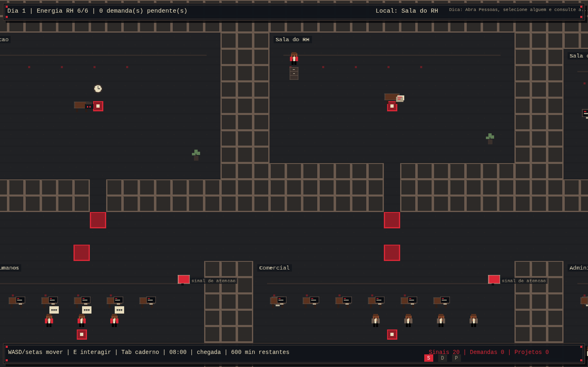

# GPRH — Gestão Procedural de RH

Protótipo jogável de uma simulação procedural de gestão de pessoas, desenvolvido com Node.js e Phaser.

Na versão **0.2.0**, o jogador assume o papel do RH de uma empresa gerada por seed. O desafio é entender pessoas, relações e problemas organizacionais usando conversas, observações e instrumentos de RH — sem acesso onisciente aos dados reais da simulação.

## Estado do projeto

A v0.2 entrega um loop diário jogável com escritório navegável, rotina dos funcionários, demandas, decisões, projetos, passagem do tempo, consequências e relatório de fim de dia.

Principais recursos:

- empresas, setores, funcionários, relações e escritórios gerados proceduralmente;
- funcionários com posto de trabalho, deslocamentos coerentes, pausas, copa e encontros sociais;
- simulação de produtividade, entregas, sobrecarga, clima, confiança, risco de saída e compliance;
- informação imperfeita: o RH precisa investigar para transformar sinais em conhecimento;
- fila de demandas e mais de 100 decisões-base, expandidas contextualmente para centenas de opções;
- ações com alvo explícito, custo de tempo, energia, prévia e consequências;
- projetos de RH, tecnologias organizacionais e dashboard desbloqueável;
- interface pixel art minimalista com mapa, HUD, caderno e relatório diário;
- autosave v3 com migração, continuação da campanha e reinício protegido por confirmação;
- simulação determinística: a mesma seed reproduz a mesma empresa.

## Loop de jogo

1. Observe o escritório e os sinais disponíveis.
2. Converse com funcionários e consulte instrumentos de RH.
3. Priorize demandas, pessoas, setores e projetos.
4. Invista tempo e energia em ações com alvos explícitos.
5. Acompanhe mudanças de rotina, relações e produtividade.
6. Encerre o expediente e analise o relatório parcial.
7. Ajuste a estratégia para o dia seguinte.

## Captura do protótipo



Captura do protótipo jogável, com uma empresa fictícia gerada pelo jogo.

## Controles

| Tecla | Ação |
| --- | --- |
| `WASD` ou setas | Mover pelo escritório |
| `E` | Interagir |
| `Tab` | Abrir ou fechar o caderno |
| Teclado | Buscar e filtrar no caderno |
| `Esc` | Voltar ou fechar painel |

## Executar localmente

Requisitos:

- Node.js 20 ou superior;
- npm.

Instale as dependências:

```bash
npm ci --prefix ui-phaser
```

Inicie o jogo:

```bash
npm --prefix ui-phaser start
```

Acesse [http://127.0.0.1:4180](http://127.0.0.1:4180).

O autosave local é armazenado em `ui-phaser/.runtime/` e não é enviado ao Git.

## Testes

Execute a suíte completa:

```bash
node tests/runAllTests.js
```

Ou use o comando do pacote da interface:

```bash
npm --prefix ui-phaser test
```

A suíte cobre determinismo, coerência procedural, rotinas, trabalho, relações sociais, visibilidade de informação, decisões de RH, persistência, organograma, tecnologias e integração da interface Phaser.

## Arquitetura

| Diretório | Responsabilidade |
| --- | --- |
| `core/` | RNG determinístico, IDs e utilitários compartilhados |
| `data/` | Catálogos e dados de cenário |
| `generators/` | Geração procedural de empresa, setores, pessoas e relações |
| `simulation/` | Rotina, trabalho, clima, finanças, compliance e eventos |
| `knowledge/` | Percepção do RH, sinais visíveis e desbloqueio de informação |
| `rh/` | Ações, energia, demandas, aprovações e tecnologias |
| `game/` | Loop diário/semanal, mapa, snapshots, objetivos e saves |
| `reports/` | Relatórios e métricas de acompanhamento |
| `ui-phaser/` | Interface jogável em Phaser |
| `ui-simple/` | Interface técnica alternativa |
| `tests/` | Testes automatizados e calibração por seeds |

As regras permanecem na engine e a interface consome snapshots. Essa separação permite evoluir organograma, dashboards, processos, tecnologias e crescimento organizacional sem acoplar a simulação ao Phaser.

## Calibração da v0.2

Uma rodada com 10 seeds comparou três estilos ao longo da simulação:

| Estratégia | Pontuação média |
| --- | ---: |
| RH informado | 73,5 |
| RH mal direcionado | 71,2 |
| Nenhuma ação | 70,7 |

A estratégia informada superou a inação em 2,8 pontos, em média. O principal ponto de balanceamento ainda aberto é reduzir situações em que riscos altos permanecem ocultos por tempo excessivo.

## Próximos passos

- balancear a descoberta de riscos sem remover a informação imperfeita;
- ampliar feedback visual e sonoro;
- aprofundar organograma, carreira e evolução organizacional;
- realizar sessões externas de playtest e ajustar duração, dificuldade e clareza.

## Versão

Versão atual: **0.2.0 — protótipo jogável**.
